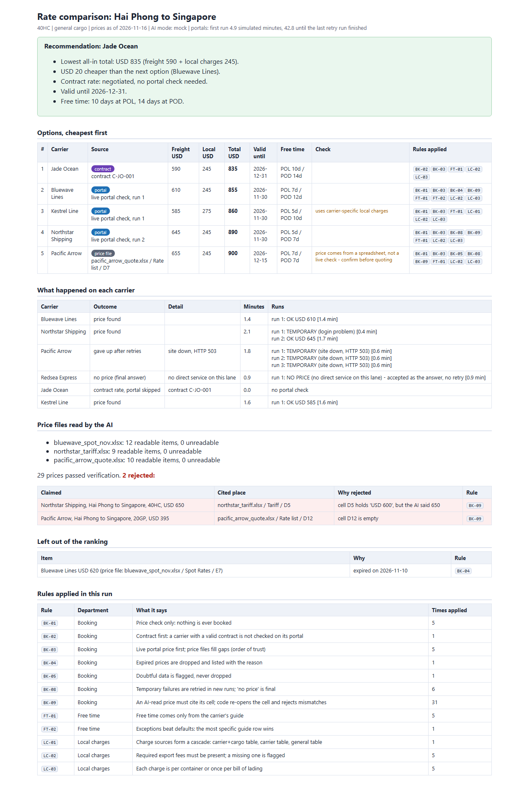

# Logistics Automation Portfolio

I am Nguyen Minh Hieu. I studied finance. From May to November 2026 I worked at APS Group, a Vietnamese freight forwarder, as an Operations Executive. In that role I removed repetitive work from the sales, booking, trucking, customs and marketing teams.

**How I built these:** I designed four of these systems and built them with an AI coding assistant (Claude Code). The fifth, the sailing-schedule pipeline, already existed; I took it over and extended it. I gathered the requirements, defined the workflows, business rules and checks, tested with staff, and ran the systems in production. I owned the problem, the rules, the design choices, the tests with real users, and the decision of when each system was safe to switch on.

This repository describes that work. It has no company code, no real data and no internal details. The only code here is three original demos, built the same AI-assisted way, that anyone can run.

## The five case studies

| # | Case study | One-line outcome |
|---|---|---|
| 1 | [Freight quote engine](case-studies/01-freight-quote-engine.md) | Checks prices on 6 carrier portals and in staff price sheets. Quote prep went from hours to minutes (a full check of all 6 carriers takes 9 to 14 minutes, unattended). |
| 2 | [Lead-to-quote workflow](case-studies/02-lead-to-quote-workflow.md) | A new customer lead is handed to the departments that price it, with a 30-minute deadline and reminders, and comes back as one combined quote. |
| 3 | [AI answers you can check](case-studies/03-ai-answers-you-can-check.md) | The pattern behind everything: the AI must cite where it read each number, and plain code re-checks the citation before staff see it. |
| 4 | [Sailing schedule pipeline](case-studies/04-sailing-schedule-pipeline.md) | Schedules from 8 carriers land in one table every day, with checks that catch silent data loss. |
| 5 | [Marketing content pipeline](case-studies/05-marketing-content-pipeline.md) | Ideas are collected, filtered, drafted by AI and published after two human approvals. |

The systems served 5 departments in total: sales, booking, trucking, customs and marketing.

## Demos

Three runnable re-creations with fictional data. Each one runs offline with recorded AI answers (or live with Claude or Gemini), has automated tests, and traces every business rule it applies by ID.

| Demo | What it shows | Tests |
|---|---|---|
| [`quote-engine-demo`](quote-engine-demo/) | A full customer lead: dispatch to Booking, Trucking and Customs with deadlines and reminders; carrier portals checked one after another inside a shared time budget; price files read by AI with every cited cell verified; local charges, free time, fuel-indexed trucking, HS code and duty lookup; Sales Support picks the options and sets the margin; one combined customer quotation. 42 department rules. | 270 |
| [`schedule-pipeline-demo`](schedule-pipeline-demo/) | Schedules from five carriers in different formats, de-duplicated by voyage key, ghost sailings retired without touching booked rows, and a health check that catches a run reporting success while losing data. 19 rules. | 68 |
| [`marketing-pipeline-demo`](marketing-pipeline-demo/) | Ideas collected and de-duplicated by content, an AI relevance filter, two human approval gates, AI drafts that refuse thin sources, golden-hour scheduling and per-platform publishing rules. 18 rules. | 54 |

## The stack, in plain words

- **Python and Node.js scripts** do the work: read files, call carrier websites and APIs, make PDFs.
- **Browser automation** is used where a carrier has a web portal but no usable API.
- **A no-code team database** is where staff work. They tick a box or press a button, and the result appears in the table.
- **A small service on an office PC** receives those button presses, queues the jobs and writes results back.
- **A visual workflow tool** handles a few simple jobs, such as sending PDFs and emails.
- **A cloud database** stores schedule data.
- **Windows scheduled tasks** run the daily jobs.
- **Claude** (the AI model) reads messy files and drafts text. Plain code checks its answers.

## Confidentiality

Employer and public carrier names appear because they are public. Everything else is described in business and architecture terms only. No prices, customers, staff, account details, screenshots or internal identifiers are included.

## License

MIT. See [LICENSE](LICENSE).
