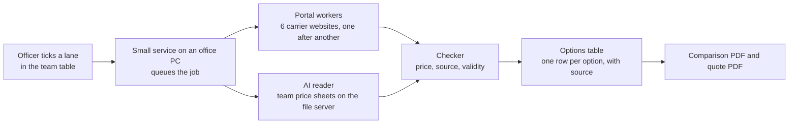

# 1. Freight quote engine

## The problem

The booking team prices sea freight. A customer asks for a rate from one port to another. To answer, a booking officer has to find the best price for that lane. They open several carrier websites one by one, log in, type the route, read the price, and write it down. They also look through the team's own price sheets, where colleagues have saved rates that carriers sent by email.

This is slow, and it is the first step of every quote. While the officer searches, the customer waits and sometimes goes to another forwarder.

## How it was done before

Everything by hand. Each lane meant many browser tabs, copy and paste, and a manual comparison in a spreadsheet. The result depended on who did it and how much time they had. Sometimes a carrier or a price sheet was simply skipped.

## What I built

An officer ticks a box on a lane in the team's shared table. A few minutes later the table shows price options from every source, and they can export a comparison PDF or a quote PDF.

How it works:

- **Portal workers** drive a real browser, log in to each carrier portal, enter the lane and read the price. Carriers are checked one after another, each with its own time limit, so one slow or broken portal cannot hold up the whole job forever. If the team already holds a contract rate with a carrier, that carrier's portal is skipped. The AI reader works on the price sheets at the same time.
- **The AI reader** opens the team's hand-written price sheets and finds prices for the same lane. These sheets have no fixed layout, so a fixed parser would break. See case study 3 for how its answers are checked.
- **Local charges** (fees at the origin port) are added from the team's standard tables, so the options are comparable.
- **Every option keeps its source**: which carrier, which portal page or which cell of which file. Staff can always see where a number came from.

## Key decisions and trade-offs

- **Price check only, never booking.** The workers never press a "book" or "confirm" button. A carrier sometimes shows a price even when booking is blocked for that lane. The team told me that number is still useful as a reference, so I keep it and mark it.
- **Browser automation instead of waiting for APIs.** Most carriers do not offer a usable price API. A browser is slower and breaks when a website changes, but it works today. Where a carrier does have a real API, I used it, because it is more stable.
- **Live portal first, price sheets second.** The portal gives today's price. The sheets fill gaps and cover carriers without a portal.
- **A manual path always exists.** If a lane cannot be found, the officer can type a price by hand and it flows into the same quote. Customers cannot wait for me to fix code.
- **Run on an office PC.** It is cheap and the portals' logins and browser sessions live there. The cost is that the PC must stay on.

## What went wrong, and how it was fixed

- **A portal got stuck on its login page** with no error message. Guessing would have wasted time, so I made the worker save a screenshot and the page text every time this happens. The next failure then comes with evidence.
- **Carriers limit how fast you can ask.** Some block or slow you down. I added pauses, per-carrier limits and a switch to turn one carrier off without touching the rest.
- **Two jobs grabbed the same browser** when staff clicked at the same time, and one of them came back empty. I added a lock so only one job uses the shared browser at a time, and the other waits its turn.
- **A failed portal used to mean a failed quote.** Now temporary errors (site down, login problem, timeout) are retried automatically for that carrier only, after 10 and then 25 minutes, so staff do not have to click again.
- **Wrong or missing ports.** The same city can appear under two names in two carrier systems. I kept a mapping table and made the tool say "lane not found" instead of returning a price for a nearby port.

## Results

- Quote preparation dropped from hours to minutes. In the run logs, checking one carrier took about 1.5 minutes, and a full check of all 6 carriers took 9 to 14 minutes, with no one at the keyboard.
- Every price shows its source, so a second person can check it in seconds.
- Booking staff tested it on real lanes. Their feedback drove most of the later changes.

## What I would do differently

- Start with the manual-entry path and the "source for every number" rule on day one. I added both later.
- Run the service on a small managed server, not a desktop PC.
- Write the live-versus-expected checks for each portal before the first release, not after the first breakage.

## Try it

A runnable re-creation with fictional data: [`quote-engine-demo`](../quote-engine-demo/).
