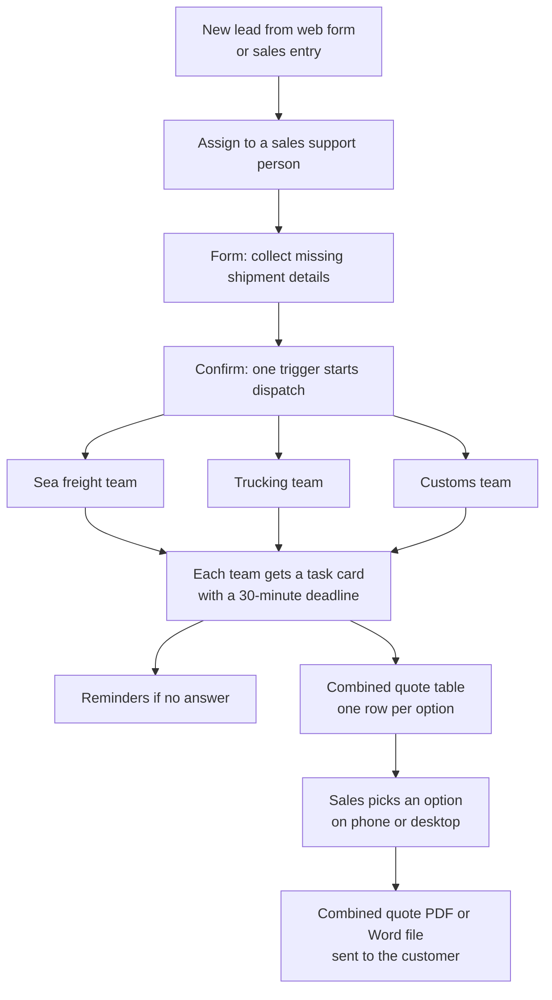

# 2. Lead-to-quote workflow

## The problem

A quote for a customer needs input from several departments. The booking team prices sea freight. The trucking team prices the road leg. The customs team estimates clearance costs and checks rules for the goods. A sales person collects all of it and sends one offer.

Each request was passed around by chat and phone. Nobody could see who was waiting for whom. Slow replies lost customers, and nobody could say where the time went.

## How it was done before

A sales person messaged each department separately, then waited. Answers came back in different formats at different times. Chasing was manual. Combining three answers into one document took another round of copy and paste.

## What I built

One flow from a new customer lead to one combined quote.

How it works:

- **One confirm, three tasks.** When sales confirms a lead, the system creates a task for each of the three departments at once. Each team gets a chat card to accept it, enter a manual price if needed, and mark it done.
- **A 30-minute deadline** is set on each task. Reminders go out at fixed steps until the team answers. Progress per department shows on the combined quote row, so sales sees who is still working.
- **The combined quote** reads the three department outputs and builds one document for the customer. Sales picks the option on a chat card, even from a phone.
- **Most pieces are native features of the team's database tool** (forms, triggers, tasks). Custom code handles only what the tool cannot do, such as running the price checks and building PDFs.

## Key decisions and trade-offs

- **Use the tool staff already open.** I did not build a new app. People work in the shared table and chat, so adoption cost was close to zero.
- **Departments only propose, sales decides.** Each team gives options. Sales picks the option and profit. This matches how the business works and avoids teams fighting over final numbers.
- **Native automation first, custom code second.** Native automation is easier to hand over. But it has limits, so I kept a thin layer of code for the hard parts.
- **Copy an existing pattern.** Once one department worked, I built the next one the same way. Staff learned one habit, not three.

## What went wrong, and how it was fixed

- **A trigger did not fire when a row was created**, only when it was edited. I split the step into "create" then "update". I wrote this down as a rule for every later automation.
- **Many leads at once** caused two dispatches for the same lead to run together. I added a lock per lead and a limit on parallel leads.
- **Testing in working hours messaged real people.** After this I added a test mode that redirects every message to me.
- **Deleted test rows still sent reminders.** A scheduled step kept running after its row was deleted. The fix: switch off the automation first, then delete test data.
- **A broken step switched a whole automation off** under heavy load. I now check that the automations are still enabled after busy periods.

## Results

- Work reaches three departments at the same moment, with a clear deadline.
- Sales can see status per department instead of asking in chat.
- One combined quote document replaces three separate answers.

## What I would do differently

- Measure the time from lead to quote from the first day, so the result is a number and not a feeling.
- Write the test mode before the first live pilot.
- Keep a written list of the database tool's quirks from the start. I rebuilt that list from memory after each surprise.

## Try it

A runnable re-creation with fictional data: [`quote-engine-demo`](../quote-engine-demo/).
