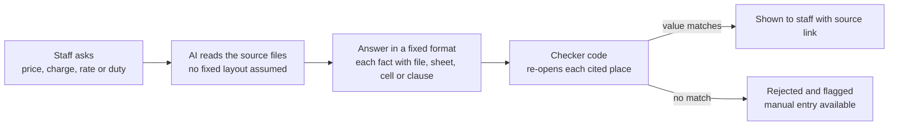

# 3. AI answers you can check

## The problem

Several teams look up facts in messy documents. Booking needs carrier prices and local charges. Trucking needs rates from many transport vendors. Customs needs duty rates and rules for one product. The files are spreadsheets, PDFs and legal texts. Every carrier, vendor and regulation has its own layout, and the layouts change.

An AI model can read these well. The risk is that it reads one cell wrong or states something that is not in the file. In freight, a wrong number in a quote is a real loss, and a wrong customs answer can mean fines. A smooth sentence is not proof.

## How it was done before

Staff searched the folders by hand. For each answer they opened the file, found the line, and typed the number. It worked but it was slow, and the result depended on the person.

## What I built

One pattern, used in four places: **the AI answers, but must cite exactly where it read each fact. Plain code then checks the citation. Staff see only what passed.**

Where it is used:

- **Carrier prices** from the team's hand-written price sheets: each price cites its file, sheet and cell.
- **Local charges** from the standard charge tables: each fee cites its cell. Carrier-specific tables beat the general one.
- **Trucking rates** from transport vendors' price files: same cell citation.
- **Customs lookups** for one product: tax rates, policy and procedure. The AI must cite the tariff line and the legal document. Code checks that the tariff code exists and that the quoted text is really in the cited document.

The [quote engine demo](../quote-engine-demo/) runs the same check on fake price files: the AI cites a cell for every price, and the code rejects any price that does not match its cell.

## Key decisions and trade-offs

- **The AI reads freely. Code only verifies.** I wrote no rules for file layouts, names or dates. Rules like that break when a carrier changes a template. The AI copes with new layouts. The checker does not need to know about layouts at all, only whether the cited place says what the AI claims.
- **Reject, do not repair.** If a citation fails, the row is dropped and flagged. I do not "fix" it, because a fixed row is a guess again.
- **Read everything, flag doubtful data.** I do not drop rows I find odd. They are shown with a warning. Staff decide.
- **Always a manual path.** Staff can type a value by hand whenever the AI finds nothing or is rejected. The customer is waiting, not the code.
- **The checker is cheap.** It is plain code and runs in milliseconds. For local charges, the AI re-reads the tables only when the files change.

## What went wrong, and how it was fixed

- **Notes written once went stale.** Early on, an answer came from a summary of the folder that no longer matched the files, and it was wrong in several places. Now the AI re-reads the full folder each time, and anything that can be counted is counted by code.
- **The same file under two names.** In one folder, several vendor files were exact copies of each other. They looked like separate quotes. The system now flags "identical copy" instead of treating them as independent evidence.
- **Layouts change without warning.** A fixed parser would have broken each time. This is the main reason I let the AI read freely and kept the checker layout-blind.
- **Known limit.** A value match proves the number is in the cited cell. It does not prove the cell belongs to the right lane or column. The demo has the same limit, and says so. A stronger check would also compare row and column labels.

## Results

- Staff see a source next to every AI-found number and can verify it in seconds.
- Wrong or invented values are rejected before they reach a quote. The demo shows this with two deliberately bad rows.
- The same pattern was reused across four lookups, so each new one was faster to build.

## What I would do differently

- Build the checker before the AI step. It forces you to define what "correct" means first.
- Keep a small set of real, checked examples per source, and re-run it after every change to prompts or files.
- Track how often a row is rejected. A rising rate is an early warning that a source changed.
