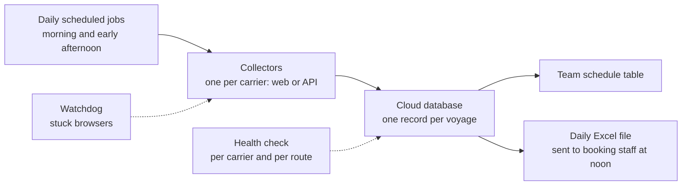

# 4. Sailing schedule pipeline

## The problem

The booking team needs to know which ships sail from which port, and when. Each carrier publishes its schedule on its own website, in its own format. To plan a booking, staff checked these sites one by one. Schedules also change: a ship is swapped, a departure date moves.

## How it was done before

People opened carrier sites by hand and copied dates into the team's table. The data was always partly out of date. Nobody could tell which rows were fresh.

## What I took over, and what I added

The pipeline already existed when I joined in May 2026: it collected schedules from two carriers. I took it over and extended it into a set of collectors for 8 carriers that run twice a day, merge everything into one clean table, and send the booking team a daily Excel file for the cargo they care about.

What I added and fixed:

- **More carriers**, up to 8, including one through the carrier's official API instead of its website.
- **Duplicate clean-up.** The departure date was part of a voyage's identity, so every date change created a new record. I changed the key and removed the stale copies, which were about 65% of the active database rows, without touching any row linked to a booking.
- **Ghost retirement**, a **second daily run** for a carrier that changes sailings during the day, **health checks** per carrier and per route, and **self-recovery** for stuck browsers.

How it works:

- **One collector per carrier.** Some use a carrier's real API. Others open the carrier website with a browser. Each writes the same record shape: carrier, route, vessel, voyage, departure, arrival.
- **Upsert, not append.** A voyage is matched by a stable key. A new run updates the existing record instead of creating a copy.
- **Ghost voyages are retired, not deleted.** If a carrier swaps a ship, the old voyage is marked inactive. It is not removed.
- **Rows that have bookings are never deleted.** This rule is absolute.
- **A health check** goes beyond "the job said success". It looks at each carrier's errors and counts voyages per route.

## Key decisions and trade-offs

- **Collect often, but not every minute.** Carrier sites limit repeated calls. Two runs a day is enough for planning and keeps us under their limits.
- **Retire, do not delete.** Deleting is final. Marking inactive costs a little clutter and removes the risk of destroying a record someone needs.
- **A written health-check checklist, not just alerts.** Failures in this system are quiet. A checklist that a person or an AI can follow finds more than a green light.
- **Priority routes list.** The daily run collects the routes we care about. This keeps it fast and avoids requests for routes nobody uses.
- **Run on a PC with scheduled tasks.** Simple and cheap. The cost is that a sleeping or switched-off PC means a missed run, so I wrote down how to recover.

## What went wrong, and how it was fixed

- **"Success" with missing data.** The top-level result said the run succeeded, while one carrier had lost many voyages because errors for single routes were swallowed. I now check per-carrier errors and per-route counts, and compare with the carrier site for a sample.
- **Same city, two terminals.** One carrier has two ports for the same city. A wrong choice returned empty results for that route. I fixed the route setup and added a per-route count check.
- **Stuck browsers.** Some runs froze for hours and left many browser processes behind. I added a time limit per call, a step that discards a sick browser, and a watchdog that restarts it.
- **Carrier rate limits.** One carrier returned empty replies after many calls in a row. I added longer gaps and slower retries.
- **A login that expired** made one carrier fail every day until someone noticed. The health check now lists it, and there is a documented re-login step.

## Results

- Schedules from 8 carriers land in one table twice a day without manual copying.
- Stale duplicates (about 65% of active database rows) removed, with booking-linked rows protected.
- Booking staff receive a daily Excel file at noon for their main cargo.
- Silent failures are now caught by the daily check instead of by a booking officer finding a wrong date.

## What I would do differently

- Add automatic alerts for the checks I do by hand. A person should not have to remember to look.
- Test each collector against the live site on a schedule and report differences.
- Run it on a server that does not sleep.

## Try it

A runnable re-creation with fictional data: [`schedule-pipeline-demo`](../schedule-pipeline-demo/).
