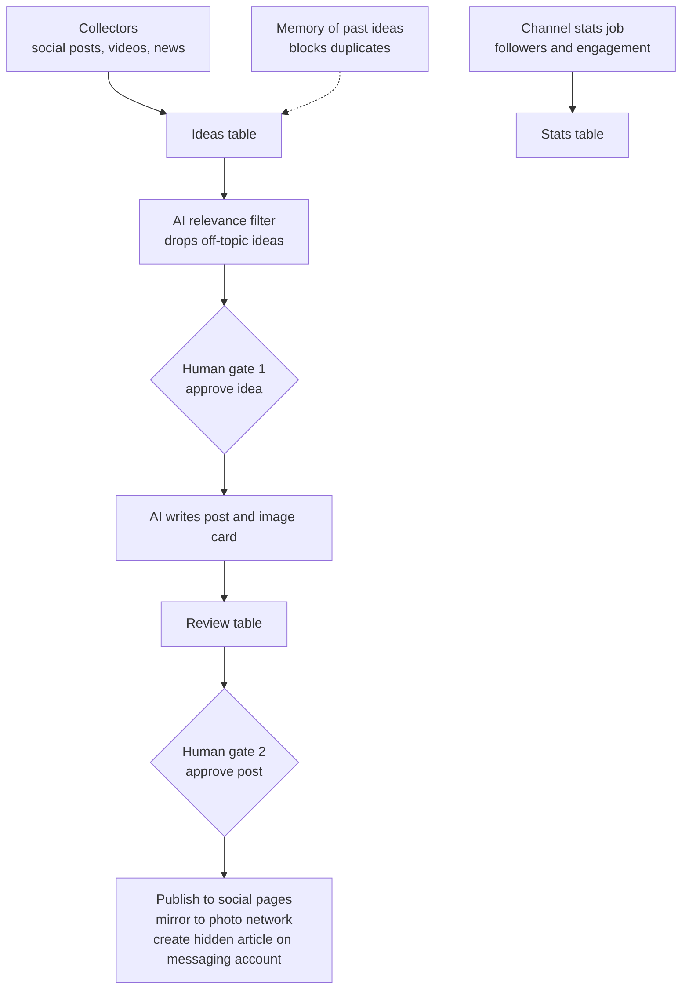

# 5. Marketing content pipeline

## The problem

The marketing team posts regularly on social media and on a messaging platform's official account. Good posts need ideas, research, writing, an image and posting on several channels. Doing this for every post is slow. Ideas also repeat, and some are off topic for a freight forwarder.

## How it was done before

A person scrolled social feeds and news sites for ideas, wrote each post, made the image, and posted by hand on each channel.

## What I built

A pipeline where machines do the collecting and drafting and people make the decisions. There are two human approval steps.

How it works:

- **Collectors** run on a schedule. They pull posts from selected social pages, videos and news sites, and write ideas to a table.
- **A memory of past ideas** stops the same idea from coming back. Social links change every time you view them, so it compares by content, not by link.
- **An AI filter** removes ideas that are not relevant to the business, so people do not review noise.
- **After approval, the AI drafts** the post text and builds an image card from a template.
- **Publishing** goes to the company's pages. The photo network gets a mirrored copy where it fits. The messaging account gets a hidden draft article, and the team presses publish themselves.
- **Scheduling** lets the team pick a time or a "best hours" slot.
- **A stats job** reads follower and engagement numbers several times a day into a dashboard table.

## Key decisions and trade-offs

- **Two human gates.** The AI is useful for volume but not trusted with the company voice. Nothing is posted without a person approving the idea and the text.
- **Staff can edit and redo.** Changing the script text triggers a new draft, so people stay in control without learning a new tool.
- **Drafts, not auto-publish, for the messaging account.** The platform limits articles per month, so the team chooses what to spend them on.
- **Fail visibly.** If a source gives too little text, the post is marked "missing source" instead of being filled with invented text.
- **Self-run tools, no paid scraping service.** I keep the collectors in my own code. It costs more build time but there is no per-use fee and I control the behavior.

## What went wrong, and how it was fixed

- **A collector reported success but wrote nothing.** A scheduled job's result code does not mean data arrived. I now count ideas per source per day, and a source that drops to zero is treated as a broken collector, not "no news".
- **Login sessions expired.** The social collector needs a logged-in session. When it expired, ideas became thin. I documented the re-login step and added a check on the amount of text gathered.
- **Duplicate ideas** appeared because social links change. Fixed with the content-based memory above.
- **Access keys expired** for some channels, which broke posting. I added a keep-alive job for the one that expires fastest, and wrote down how to refresh the others.
- **A folder clean-up broke live jobs.** I once moved files that scheduled jobs used. Several jobs failed silently for weeks. My rule now: never move or delete files in a live folder unless I have listed every file, with the reason, and checked the output of each job afterward.

## Results

- Ideas arrive every day without anyone scrolling feeds.
- The team spends its time on choosing and editing, not on searching and formatting.
- Posts go to several channels from one approval.

## What I would do differently

- Measure the time per post before and after from day one, so the time saved has a hard number.
- Keep every key and password in environment variables from day one, with a secret scanner on every commit.
- Add alerts to the checks I do by hand, such as "no new ideas today".

## Try it

A runnable re-creation with fictional data: [`marketing-pipeline-demo`](../marketing-pipeline-demo/).
