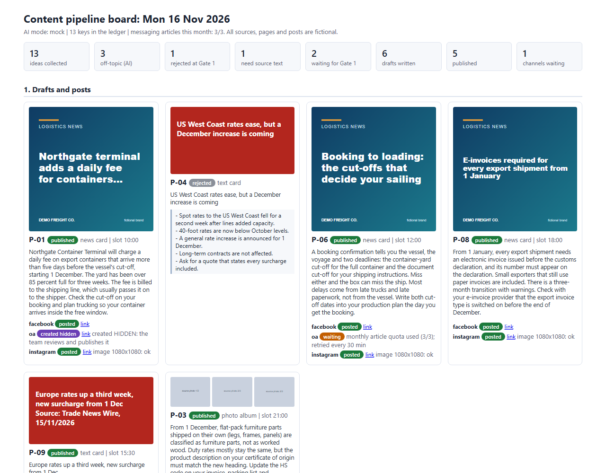

# Marketing content pipeline demo

A runnable re-creation of the marketing content pipeline described in
[case study 5](../case-studies/05-marketing-content-pipeline.md). All sources, pages, posts and texts are fictional,
and nothing is posted anywhere: the platforms are simulated.



## What it shows, in 30 seconds

One simulated working day. Machines collect and draft; editors decide at two gates; the board shows every idea's
status at the end.

1. **Collect** social posts, videos and news items twice a day. Below the bar (25 reactions, 1,000 views, news older than 24 hours) = not written. A source that returns nothing is reported as a broken collector, not as "no news".
2. **Never the same idea twice.** Social links change on every visit, so a post is keyed by its page and first 100 characters; videos by platform id; news by URL without tracking parameters. Keys go into a ledger that is never emptied.
3. **AI relevance filter, with reasons.** An outage marks nothing and waits for the next cycle. A reply with missing verdicts is asked again, then the batch is split. One idea that never gets a verdict is kept for a human.
4. **Gate 1: an editor approves ideas.** Only approved ideas are written.
5. **AI draft that follows the team's rule files** in [`prompts/`](prompts/). A source under 500 characters, or visibly cut, is not sent to the AI: it is flagged "needs source" and runs again only when an editor changes the text. At Gate 1 only, the AI may answer "NOT ENOUGH SOURCE". Code decides the source name, whether to credit it and the date, and adds the source line if the AI drops it. Banned phrases trigger one rewrite, then a flag.
6. **Card and format rules:** news card (image card, no author comment), text card (at most 120 characters plus an author comment), photo album (the source's own photos). Headlines at most 60 characters and 3 lines.
7. **Gate 2: an editor approves, rejects or asks for a redo.** Redo rewrites the part the feedback is about, from the saved source.
8. **Scheduling:** now, a fixed time, or a golden hour (07, 12, 18, 21): the nearest free slot.
9. **Publish with platform rules:** Facebook page post; Instagram mirrors single-image posts only; the messaging account gets a separate article, created **hidden** for the team to publish themselves, with a monthly quota. Each channel succeeds or fails on its own.
10. **The board:** every idea, every post with its card and channel links, the publish log, collector counts and the rule trace.

## Run it

You need Python 3.10 or newer. No API key is needed for the default (mock) mode.

```bash
cd marketing-pipeline-demo
python -m venv venv && source venv/bin/activate      # Windows: venv\Scripts\activate
pip install -r requirements.txt

python marketing.py run          # one simulated day with recorded AI answers
python marketing.py rules        # list the MK-xx rules
pytest
```

Then open `output/board.html` in a browser. A ready-made run is in [`docs/sample_output/`](docs/sample_output/).

The editors' choices are in [`decisions/gate1.csv`](decisions/gate1.csv) and [`decisions/gate2.csv`](decisions/gate2.csv)
(time, item, action, options). Change a row and run again: approve another idea, pick a different format, move a post
to a golden hour. The recorded AI answers are in [`fixtures/llm/`](fixtures/llm/), including the deliberately bad ones.

### Live mode (real AI)

The platforms are always simulated. `--live` only changes who answers the prompts.

```bash
pip install anthropic                        # or: pip install google-genai
export ANTHROPIC_API_KEY=...                 # names only in .env.example
export CLAUDE_MODEL=claude-opus-5-5          # optional; this is the default
python marketing.py run --live

# Gemini instead:
export LLM_PROVIDER=gemini GEMINI_API_KEY=...
```

A live AI will not give the recorded answers, so statuses can differ. Whatever it returns goes through the same rules.
With Claude, the server-side refusal fallback is switched on: a declined request is re-run on a fallback model in the
same call.

## Sample console log (shortened)

```
06:00
  COLLECT (visit 1)
    social posts   6 seen -> 5 new, 1 below 25 reactions [MK-01], 0 already in the ledger (link changed, content key matched) [MK-02]
    news           Harbour Bulletin: 0 items -> COLLECTOR PROBLEM: a source that returns nothing is treated as broken, not as 'no news today' [MK-18]
  relevance filter: 12 new idea(s), batches of up to 25
    AI unavailable (planted outage: the AI service did not answer) -> nothing marked, the filter runs again next cycle [MK-04]

06:30
    reply had 9 verdicts for 12 ideas (missing I-10, I-11, I-12)
    -> asking once more
    -> splitting the batch: I-01..I-06 and I-07..I-12
    I-02 OFF-TOPIC  "Photos from last night's celebrity wedding are everywhe" - celebrity news, nothing about trade or logistics [MK-03]

08:30
  GATE 1 decisions by the editor (9)
    I-07 approve: ignored, it was removed by the relevance filter
  Gate 1 writing: 7 idea(s)
    I-01 headline has 85 characters > 60 -> cut at a word to 53 [MK-11]
    I-03 NEEDS SOURCE: main text 282 characters < 500, no AI call -> editor sees the text the pipeline read [MK-06]
    I-08 voice check: uses 'guaranteed', 'act now' -> asking once more with the list [MK-09]
    I-08 source line missing in the AI caption -> appended by code [MK-08]
    I-11 NEEDS SOURCE: the AI refused: "the article does not say what the new gate hours are or when they start." -> editor sees the text the pipeline read [MK-07]

09:30
    I-03 source text changed by an editor -> writing again [MK-06]
    I-03 -> P-03 photo album: "New HS code notes for flat-pack furniture parts" | 3 photos

10:00
    P-06 approved: facebook + oa, golden hour 12:00 [MK-14]
    P-09 rewritten from the saved source (no new scrape, no refusal allowed): "Europe rates up a third week, new surcharge from 1 Dec" -> back to review
    P-01 facebook: HTTP 500: planted server error -> this channel stays open and is retried next cycle; other channels are not affected [MK-15]
    P-01 oa: article "Northgate terminal: new fee for containers delivered too early" created HIDDEN (team publishes it; quota 3/3 this month) [MK-17]

12:00
    P-06 facebook: posted (card image) https://facebook.example/demo-freight-co/posts/100004
    P-06 instagram: mirrored the same image and caption (ratio 1.00, ok) [MK-16]
    P-06 oa: monthly article quota used (3/3) -> article waits, retried every 30 min; other channels are not affected [MK-17]

14:00
  COLLECT (visit 2)
    social posts   6 seen -> 1 new, 1 below 25 reactions [MK-01], 4 already in the ledger (link changed, content key matched) [MK-02]

21:00
    P-03 instagram: skipped (album of 3 photos; mirror takes single-image posts only) [MK-16]

END OF DAY
  ideas: 13 collected | drafted 6, filtered 3, rejected 1, needs source 1, pending 2
  posts: 6 drafts | published 5, rejected 1
```

The full log is in [`docs/sample_output/run.log`](docs/sample_output/run.log).

## The rules

| ID | Rule | What it does |
|---|---|---|
| MK-01 | Collect thresholds | 25 reactions, 1,000 views, news not older than 24 hours |
| MK-02 | Content keys and a permanent ledger | Page + first 100 characters for social posts; platform id for videos; clean URL for news |
| MK-03 | AI relevance filter with reasons | Batches of 25; ask again, then split; one idea without a verdict is kept |
| MK-04 | AI outage: mark nothing | Nothing marked either way; try again next cycle |
| MK-05 | Gate 1: the editor approves ideas | Only approved ideas are written; rejected ones keep their ledger key |
| MK-06 | Source too thin: flag, do not write | Under 500 characters or visibly cut: no AI call, "needs source", re-run when the text changes |
| MK-07 | The AI may refuse only at Gate 1 | "NOT ENOUGH SOURCE" accepted at Gate 1; redo and articles never refuse |
| MK-08 | Facts come from code | Source name, credit or not, date; source line added if the AI drops it |
| MK-09 | Voice rules are checked | Banned phrases: one rewrite, then a flag for the reviewer |
| MK-10 | Format rules | News card, text card (120 characters + author comment), photo album |
| MK-11 | Card rules | Headline at most 60 characters and 3 lines; 1080x1080 card, 1280x720 cover |
| MK-12 | Gate 2: nothing is published without approval | Rejected drafts are never posted |
| MK-13 | Redo from the saved source | Scope guessed from the feedback words; request used once |
| MK-14 | Scheduling and golden hours | Now, fixed time, or the nearest free slot at 07, 12, 18 or 21 |
| MK-15 | Each channel succeeds or fails on its own | Own done flag and link; a failed channel retries alone |
| MK-16 | Instagram mirrors single-image posts only | Text posts and albums skipped; ratio padded or cropped to 0.8-1.91 |
| MK-17 | Messaging articles: hidden, with a monthly quota | Created hidden for the team to publish; quota reached = wait and retry |
| MK-18 | A silent source is a broken collector | Zero items is reported, not treated as "no news" |

The board ends with this table and how many times each rule fired.

## How the demo maps to the real system

| Demo module | Real system component | What is the same | What is simplified |
|---|---|---|---|
| `marketing.py` `run_day()` | One polling process on an office PC, a cycle every minute | Same order in a cycle: publishing side first (redo, post), then filter and writing | A simulated day with 30-minute cycles |
| `engine/decisions.py` | Two dropdowns in the team's tables (idea approval, draft review) | Gate 1 approve/reject; Gate 2 approve, redo with feedback, reject; a stale decision is not forced through | CSV files with times |
| `engine/collect.py` | Scheduled collectors: a browser with a saved login for social pages, a video tool for channels, feed and page readers for news | View and engagement floors, news age limit, counts per source, an empty source = a broken collector | Recorded files; no browser, no transcripts |
| `engine/ledger.py` | The permanent ledger table | Content keys for social posts, typed ids for videos, clean URLs for news; the ledger only grows | A JSON file |
| `engine/relevance.py` | AI relevance filter inside the loop | Batches of 25, ask again, split on an unusable reply, one item kept, outage = mark nothing | Each verdict carries a reason here; in production it is yes/no and off-topic rows are deleted with a log line |
| `engine/writer.py`, `prompts/` | Gate 1 step and the voice files owned by the content lead | Under 500 characters or cut = "needs source" with a fingerprint re-run; refusal only at Gate 1; source facts by code with a safety net; text card = short caption + comment | The banned-phrase check is applied to every draft here; short prompt files without keyword-matched knowledge chunks |
| `engine/cards.py` | Brand template with an AI background and the headline drawn on top | Fixed frame, headline fit, Instagram ratio pad/crop, 1280x720 messaging cover | SVG, no AI background |
| `engine/redo.py` | Redo with feedback | Scope guessed from keywords, rewrite from the saved source, no refusal, request used once | Same |
| `engine/slots.py` | Schedule choice per post | Now, fixed time, golden hours 07/12/18/21, slot written back | One time per post (production keeps one per page) |
| `engine/publish.py` | Facebook, Instagram and messaging-account APIs | Per-channel done flags and links, Instagram mirror for single-image posts only, articles created hidden, quota = wait and retry every 30 minutes | Simulated platforms; one Facebook page (production posts to two) |
| `engine/board.py` | The team's tables | Every status and reason visible | One HTML page |
| `engine/llm.py` | Writer and filter models behind an API proxy | One door; an outage and a refusal are handled differently | Calls the SDK directly; recorded answers by default |

## Files

```
marketing.py           command line + the whole day (start here)
engine/                one module per step, rules.py holds the MK-xx registry
prompts/               voice, relevance, post, refusal, comment and article rules (the team's files)
decisions/             gate1.csv and gate2.csv: what the editors decide, and when
fixtures/sources/      two collector visits: social posts, videos, two news feeds (one empty)
fixtures/llm/          recorded AI answers, some deliberately bad
fixtures/platforms.json  messaging quota and a planted Facebook error
tests/                 pytest (54 checks)
docs/                  screenshot and sample output (log, board, ledger, state, cards)
```

## How this was built

I designed this pipeline and built it with an AI coding assistant (Claude Code), and I built this demo the same way.
I specified the behaviour and the rules, and checked the result. The code is original and written for this repository.
It contains no company code and no real data. Sources, pages, posts and texts are invented.
