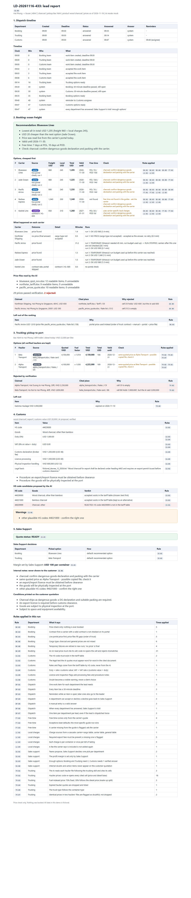
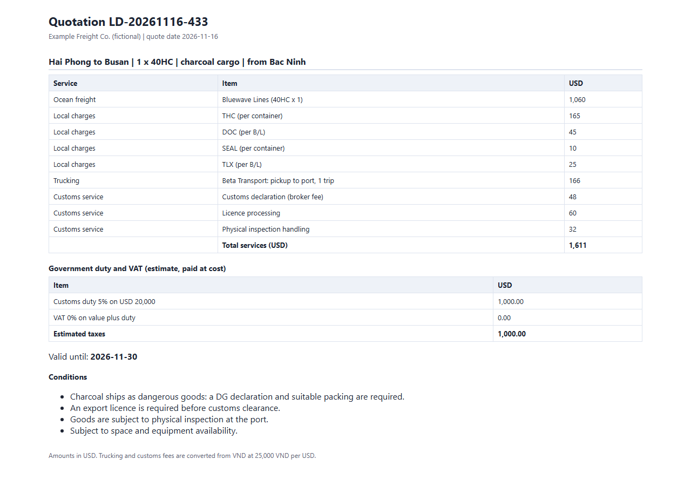

# Quote engine demo

A runnable re-creation of the freight quote engine described in
[case study 1](../case-studies/01-freight-quote-engine.md) and
[case study 3](../case-studies/03-ai-answers-you-can-check.md). It covers the whole path from a new customer lead to one
combined quotation: sea freight, trucking and customs, each with its own department rules, a simulated dispatch with
deadlines and reminders, and a Sales Support step that picks options and sets the margin. All data is fictional.

In production the same flow ran on the teams' Lark tables, a Node.js service and live carrier websites, for real customer requests. Here every outside system is replaced by a local stand-in, so it runs on any laptop: see [the real systems and the demos](../README.md#the-real-systems-and-the-demos).



## What it shows, in 30 seconds

Two ways to run it.

**One lane** (`python quote.py --pol ... --pod ...`): what a booking officer does by hand, in minutes.

1. **Contract rates first.** A carrier with a valid contract is not checked on its website.
2. **Carrier portals, one after another**, inside one shared time budget per run. Temporary failures (site down, login problem, timeout) are retried in new, smaller runs after 10 and then 25 minutes, only for the carriers that failed. "No price for this lane" is a final answer.
3. **At the same time, an AI reads messy price spreadsheets** and returns prices with the exact cell each came from. Plain code re-opens every cell and **rejects** anything that does not match. Rejected items are shown with the reason.
4. **Rules**: expired prices dropped, live portal price beats a price file, local charges from a cascade of tables, free time from the carrier's guide.
5. **Ranking** by all-in total, with a recommendation and plain-English reasons.

**A full lead** (`python quote.py lead ...`): the same, plus everything around it.

6. **Dispatch.** The lead gets a tracking code and one work item per department, each with a 30-minute deadline, reminders that escalate, accept or decline, and manual answers that count.
7. **Trucking.** The AI reads three haulier files with three different layouts; code verifies every cited cell; the price moves with the diesel price.
8. **Customs.** The AI proposes an HS code and a legal quote; code checks the code against the tariff and the quote against the document; duty and VAT are calculated from the table, never from the AI.
9. **Sales Support.** The departments propose; Sales Support picks one option per department, sets the margin and gets one combined quote. The quote is a DRAFT until every department has enough options.

It only checks prices. It never books. A manual path exists in every department and joins the same ranking.

## Department rules

Every department's rules live in its own **skill file** in [`skills/`](skills/), written like the department's own guide. Each rule has an ID.

- **The AI follows the skill file.** The Booking, Trucking and Customs readers put their skill file into the AI prompt (`engine/ai_reader.py`).
- **Code verifies every citation.** The AI must say which cell or which sentence each answer came from. Code re-opens the cell or searches the document. A wrong or invented answer is rejected and shown with the reason.
- **Code enforces the same rules.** Each rule is one function tagged with its ID (for example `@rule("BK-02", ...)`). A test checks that the IDs in the skill files and the IDs in the code are the same list, and that every ID has a test.
- **Every applied rule is traced.** The reports print the rule IDs next to each option, rejected item and warning, with a legend at the end. Any number can be traced back to the rules that shaped it.

| Department | Skill file | Rules |
|---|---|---|
| Booking | `skills/booking-price-files.md` | **BK-01** Price check only: nothing is ever booked<br>**BK-02** Contract first: a carrier with a valid contract is not checked on its portal<br>**BK-03** Live portal price first; price files fill gaps (order of trust)<br>**BK-04** Expired prices are dropped and listed with the reason<br>**BK-05** Doubtful data is flagged, never dropped<br>**BK-06** Cargo type: charcoal and general prices are not mixed<br>**BK-07** Manual entry always works, joins the same ranking, applies to this request only<br>**BK-08** Temporary failures are retried in new runs; 'no price' is final<br>**BK-09** An AI-read price must cite its cell; code re-opens the cell and rejects mismatches |
| Local charges | `skills/local-charges.md` | **LC-01** Charge sources form a cascade: carrier+cargo table, carrier table, general table<br>**LC-02** Required export fees must be present; a missing one is flagged<br>**LC-03** Each charge is per container or once per bill of lading<br>**LC-04** A fee the carrier says is included is not added again |
| Free time | `skills/free-time.md` | **FT-01** Free time comes only from the carrier's guide<br>**FT-02** Exceptions beat defaults: the most specific guide row wins<br>**FT-03** A carrier missing from the guide is flagged: ask the carrier |
| Trucking | `skills/trucking-rates.md` | **TR-01** The AI reads each haulier file following the trucking skill and cites its cells<br>**TR-02** Haulier prices: code re-opens every cited cell (price and diesel base)<br>**TR-03** Fuel-indexed price: 70% fixed, 30% follows the diesel price (made-up split)<br>**TR-04** Expired haulier quotes are dropped and listed<br>**TR-05** The truck type follows the container type<br>**TR-06** Keep alternatives: every verified haulier stays in the list<br>**TR-07** Identical prices in two hauliers' files are flagged as doubtful, not dropped |
| Customs | `skills/customs-lookup.md` | **CU-01** The HS code must exist in the tariff table<br>**CU-02** The legal text the AI quotes must appear word for word in the cited document<br>**CU-03** Rates and flags come from the tariff table by HS code, never from the AI<br>**CU-04** Duty = rate x customs value; VAT = VAT rate x (customs value + duty)<br>**CU-05** Licence and inspection flags add processing fees and procedure notes<br>**CU-06** Doubt becomes a visible warning, never a silent choice |
| Sales support | `skills/sales-support.md` | **SS-01** Teams propose, Sales Support decides: one pick per department<br>**SS-02** The profit margin is set only by Sales Support<br>**SS-03** Enough options: Booking and Trucking need 2, Customs needs 1 verified answer<br>**SS-04** Manual entries count equally with system options<br>**SS-05** One tracking code per lead, shown first on every document<br>**SS-06** Internal doubts and action items never appear on the customer quotation |
| Dispatch | `skills/dispatch.md` | **DP-01** One work item for each department the lead needs<br>**DP-02** Every item has a 30-minute deadline<br>**DP-03** Reminders while an item is open; later ones also go to the leader<br>**DP-04** A department can accept or decline; a decline goes back to Sales Support<br>**DP-05** A manual entry is a valid answer<br>**DP-06** When every department has answered, Sales Support is told<br>**DP-07** One item per department per lead, even if the lead is dispatched twice |

## Run it

You need Python 3.10 or newer. No API key is needed for the default (mock) mode.

```bash
cd quote-engine-demo
python -m venv venv && source venv/bin/activate      # Windows: venv\Scripts\activate
pip install -r requirements.txt

python data/make_sample_data.py                       # creates data/sample/

# one lane
python quote.py --pol "Hai Phong" --pod "Singapore" --container 40HC --cargo general
python quote.py --pol "Ho Chi Minh" --pod "Busan" --container 40HC --cargo charcoal
python quote.py --pol "Hai Phong" --pod "Singapore" --container 40HC --cargo general \
                --manual data/sample/manual_prices_example.csv

# a full lead: Booking + Trucking + Customs + dispatch timeline + combined quote
python quote.py lead --pol "Hai Phong" --pod "Busan" --container 40HC --cargo charcoal \
                     --pickup "Bac Ninh" --product "wood charcoal"

# the same lead when Trucking declines and Sales Support types two prices by hand,
# picks option 2 for Booking and sets the margin
python quote.py lead --pol "Hai Phong" --pod "Busan" --container 40HC --cargo charcoal \
                     --pickup "Bac Ninh" --product "wood charcoal" --decline trucking \
                     --manual-trucking data/sample/manual_trucking_example.csv --pick booking=2 --margin 120

pytest                                                # 270 tests
```

Open `output/lead_report.html` (internal) and `output/combined_quote.html` (customer). A single lane writes `output/comparison.html` and `output/customer_quote.html`. Ready-made examples are in [`docs/sample_output/`](docs/sample_output/).

Lead options: `--qty` (containers), `--direction export|import`, `--value` (customs value in USD), `--pick booking=N --pick trucking=N` (Sales Support's choice), `--margin` (per container), `--manual`, `--manual-trucking`, `--hs` (HS code typed by staff, skips the AI), `--decline trucking|customs`.
Other options: `--slow` (tiny sleeps so you can watch it), `--today 2026-11-16` (the pricing date, fixed by default so every run gives the same result).

### Live mode (real AI)

The portals are always fake. `--live` only changes who reads the price files, the haulier files and the customs documents.

```bash
pip install anthropic                        # or: pip install google-genai
export ANTHROPIC_API_KEY=...                 # names only in .env.example
export CLAUDE_MODEL=claude-opus-5-5          # optional; this is the default
python quote.py lead --pol "Hai Phong" --pod "Busan" --container 40HC --cargo charcoal \
                     --pickup "Bac Ninh" --product "wood charcoal" --live

# Gemini instead:
export LLM_PROVIDER=gemini GEMINI_API_KEY=...
```

A live AI will not give exactly the recorded answers. That is fine: whatever it returns goes through the same verification.

## Sample console log

One lane (general cargo, Hai Phong to Singapore, 40HC). The portal part is shortened; the full logs are in `docs/sample_output/`.

```
[1/6] REQUEST  Hai Phong -> Singapore | 40HC | general  | prices as of 2026-11-16
[2/6] CONTRACT CHECK
  Jade Ocean: contract USD 590 (contract C-JO-001) -> portal check skipped
[3/6] PORTALS, one after another inside a shared run budget (budget = 2 + 8.5 x carriers in the run, max 30 min)
  first pass: 5 carriers, shared budget 30.0 min (2 + 8.5 x 5, capped at 30)
  ...
[6/6] RANKING (all-in total = freight + local charges)
  1. Jade Ocean          contract   freight    590 + local  245 =    835   rules: BK-02, BK-03, FT-01, LC-02, LC-03
  2. Bluewave Lines      portal     freight    610 + local  245 =    855   rules: BK-01, BK-03, BK-04, BK-09, FT-01, FT-02, LC-02, LC-03
  3. Kestrel Line        portal     freight    585 + local  275 =    860   rules: BK-01, BK-03, FT-01, LC-01, LC-02, LC-03
  4. Northstar Shipping  portal     freight    645 + local  245 =    890   rules: BK-01, BK-03, BK-08, BK-09, FT-01, LC-02, LC-03
  5. Pacific Arrow       price file freight    655 + local  245 =    900   rules: BK-01, BK-03, BK-05, BK-08, BK-09, FT-01, LC-02, LC-03
```

The charcoal log also shows a portal that hangs: the first run uses its whole 30-minute budget and is stopped, and the carriers not reached yet are checked in a retry run.

A full lead (charcoal, Hai Phong to Busan, pickup Bac Ninh). Booking output shortened:

```
LEAD LD-20261116-433 | Hai Phong -> Busan | 40HC | charcoal | pickup Bac Ninh | product wood charcoal
=== DISPATCH: lead arrives at 09:00; work items for Booking, Trucking, Customs; deadline 09:30 ===
=== BOOKING (ocean freight) ===
  ... portals, AI reading, ranking as in the single-lane log ...
=== TRUCKING ===
  leg: Bac Ninh -> Hai Phong, 40ft trailer, 1 trip(s)
  alpha_transport.xlsx: AI returned 7 items, 7 readable
  beta_transport.xlsx: AI returned 9 items, 9 readable
  gamma_haulage.xlsx: AI returned 2 items, 2 readable
  verification: 16 accepted, 2 rejected
  left out: Gamma Haulage VND 3,950,000 - expired on 2026-11-10
  1. Beta Transport    price file quoted  4,100,000 x 1.014 =  4,159,000 VND per trip
  2. Alpha Transport   price file quoted  4,100,000 x 1.030 =  4,223,000 VND per trip
=== CUSTOMS ===
  REJECTED HS 44029999: not in the tariff table
  HS 44029000 | duty 5% = USD 1,000.00 | VAT 0% = USD 0.00 | clearance fees USD 140
  WARNING: other plausible HS codes: 44021000 - confirm the right one
=== DISPATCH TIMELINE (simulated clock) ===
  09:00  Booking team   work item created, deadline 09:30
  09:00  Trucking team  work item created, deadline 09:30
  09:00  Customs team   work item created, deadline 09:30
  09:02  Booking team   accepted the work item
  09:03  Trucking team  accepted the work item
  09:06  Customs team   accepted the work item
  09:14  Trucking team  Trucking options ready
  09:30  system         Booking: 30-minute deadline passed, still open
  09:30  system         Customs: 30-minute deadline passed, still open
  09:35  Booking team   Booking options ready
  09:40  system         reminder to Customs assignee
  09:47  Customs team   Customs options ready
  09:47  system         every department has answered: Sales Support is told 'enough options'
=== SALES SUPPORT ===
  Booking: Bluewave Lines - default: recommended option
  Trucking: Beta Transport - default: recommended option
  margin USD 100 per container, set by Sales Support
  QUOTE READY: total services USD 1,611; estimated taxes USD 1,000

```

What to notice: the contract carrier is not the cheapest all-in, because its charcoal-specific local charges (LC-01) are higher. One haulier's price comes from a matrix and one from pasted email text, and both are verified (TR-02). Two hauliers quote the same price, so both are flagged (TR-07). The invented HS code is rejected (CU-01) and a second plausible code is a warning (CU-06). Customs misses the 30-minute deadline and gets a reminder (DP-03). The quote is READY because every department has enough options (SS-03). The customer quotation below shows only conditions written for customers: the staff doubts above (copied-file suspicion, the alternative HS code, the dangerous-goods reminder to staff) stay in the internal report (SS-06).



## How the demo maps to production

| Demo module | In production | What is the same | What is simplified |
|---|---|---|---|
| `quote.py`, `engine/lead.py` | A job runner that receives the staff request, queues it and writes results back | Same order of steps; departments propose, Sales Support decides | One function call, no queue, no shared table |
| `engine/rulebook.py`, `skills/` | One guide document per department; each department's AI reader follows its guide | Rule IDs, the guide is the AI's prompt, every applied rule is traced | Seven short guides with invented numbers |
| `engine/request.py` | Route input and port-name matching | Normalise once at the front door; open lists for places | 7 ports, no port codes |
| `engine/contracts.py`, `rules.py` | Contract reader, price order of trust, validity, flags | Contract first, live price first, expired dropped, doubt flagged | CSV tables |
| `engine/portals.py` | Carrier scripts run one by one with a budget and automatic retry | Sequential carriers, one shared budget per run = min(30, 2 + 8.5 x carriers), whole run stops when it is used up, retry runs after 10 then 25 min for only the failed carriers, "no price" is final, price check only | Fake portals, simulated minutes |
| `engine/ai_reader.py`, `llm.py` | The department AI readers | AI reads any layout, answers in JSON with a citation, tolerant parsing, one re-ask | Small files, one call per file |
| `engine/verify.py` | Citation checks in every reader | Re-open each cited cell; reject with a reason; never silently drop | Checks the number and the names around the cell |
| `engine/local_charges.py`, `free_time.py` | Local charge tables and carrier free-time guides | Most specific table first, required fees, per-container vs per-B/L, guide-only free time with exceptions | Invented tables and amounts |
| `engine/trucking.py` | The trucking team's price folder and fuel formula | Messy files read by AI, cited cells verified, fuel-indexed price, alternatives kept | A made-up 70/30 fixed/fuel split; three files |
| `engine/customs.py` | The customs team's tariff lookup | HS code must exist, legal quote must be in the document, rates from the table | A tiny fictional tariff, two fictional documents |
| `engine/dispatch.py` | Work items, deadlines and reminders in the departments' tables and chat | One item per department, 30-minute deadline, escalating reminders, accept or decline, manual answers | Simulated clock; made-up reminder schedule |
| `engine/sales_support.py` | The Sales Support role | Picks, margin, "enough options", one tracking code | Command-line options instead of a table or card |
| `engine/report.py` | Comparison PDF and combined quotation | HTML printed to PDF; every number shows its source | HTML only |

Real timing, for scale: one carrier takes about 1.5 minutes. All six take about 9 to 14 minutes. The demo simulates this with minutes in a log, not real waiting.

## Files

```
quote.py                  command line: one lane, or "lead" for the full flow (start here)
engine/                   one module per step (see the table above)
skills/                   one rule file per department; the AI reads them, the code implements them
data/make_sample_data.py  builds all the fictional input data
fixtures/                 recorded AI answers per department (mock mode), some deliberately wrong
tests/                    pytest, 270 tests, at least one per rule ID
docs/                     screenshots and sample output (logs and HTML)
```

## How this was built

I built this with an AI coding assistant (Claude Code), the same way I built the real system. I specified the behaviour and the rules, and checked the result. The code is original and written for this repository. It contains no company code and no real data. Carriers, prices, contracts, tariffs and documents are invented.
