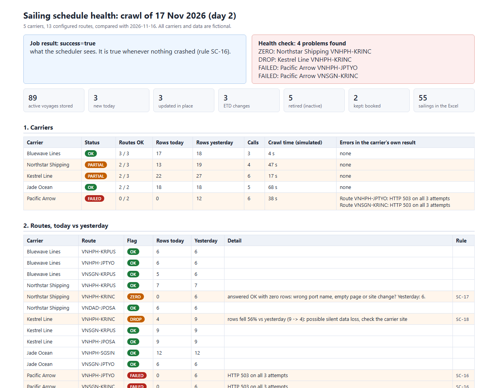

# Sailing schedule pipeline demo

A runnable re-creation of the sailing schedule pipeline I took over and extended, described in
[case study 4](../case-studies/04-sailing-schedule-pipeline.md). All carriers, vessels, bookings and data are fictional.



## What it shows, in 30 seconds

Five carriers publish their schedules in five different shapes: a JSON API, an HTML table, a CSV export per month,
an API that silently returns only the first 8 results, and an HTML page with dates that have no year. The pipeline
crawls them on two days and does what a booking team needs, every day, without anyone copying dates by hand:

1. **Crawl politely.** Carriers run in parallel; each carrier's routes run one after another with a minimum gap. Temporary errors (429, 5xx, timeouts) are retried with a growing wait; permanent ones (404) are not. An API that caps its answers gets its date window split until every sailing is found.
2. **One carrier cannot hide another.** Every route's result (rows, error, window covered) is recorded inside its carrier's result. A carrier whose site is down fails alone.
3. **Clean once, for everybody.** Port spellings become UN/LOCODEs, vessel and voyage are split or unglued, dates are parsed (never guessed), and cut-offs go into their own fields, never into the departure date. Bad rows are rejected with a reason.
4. **One row per voyage.** The key is carrier + vessel + voyage + POL + POD, with no dates. Duplicates inside a crawl keep the freshest row. A second crawl updates rows in place and logs every departure-date change, naming the bookings it affects.
5. **Retire, never delete.** A voyage the carrier stopped listing is marked inactive, but only on routes that succeeded with rows, and only inside the window that crawl covered. A voyage linked to a booking is never touched; it is flagged for the booking team.
6. **Do not trust "success".** The job says `success=true` whenever nothing crashed. The health check reads every carrier and route against yesterday: failed routes, routes that answered OK with zero rows, routes never reported, and row counts that fell by half (silent data loss).
7. **Two outputs:** a daily Excel schedule for one cargo segment (charcoal) and an HTML health report that traces every rule by its ID.

On day 2 the job still says `success=true`. The health check finds 4 problems.

## Run it

You need Python 3.10 or newer. No API key or setting is needed.

```bash
cd schedule-pipeline-demo
python -m venv venv && source venv/bin/activate      # Windows: venv\Scripts\activate
pip install -r requirements.txt

python schedule.py --day 1      # baseline crawl into a fresh database
python schedule.py --day 2      # replays day 1 quietly, then runs day 2 against it
pytest
```

Then open `output/health_day2.html` in a browser and `output/charcoal_schedule_2026-11-17.xlsx` in Excel.
Ready-made examples are in [`docs/sample_output/`](docs/sample_output/). Every run starts from an empty database, so the
result is the same each time. `--slow` adds short real sleeps so you can watch the pacing.

The carrier "websites" are recorded files in [`fixtures/`](fixtures/), with the trouble planted on purpose
(listed at the top of [`data/make_fixtures.py`](data/make_fixtures.py), which rebuilds them).

## Sample console log (day 2, shortened)

```
[1/7] CRAWL 5 carriers in parallel  | crawl day 2: Tue 17 Nov 2026
  Northstar Shipping (html_table, 3 routes, min gap 3 s + up to 2 s jitter)
    VNHPH-KRPUS  OK        7 rows   (1 call, clock   1.5 s)
    VNHPH-KRINC  OK        0 rows   (1 call, clock   6.4 s)
      VNDAD-JPOSA: timeout (no answer) (temporary) -> wait 5 s, attempt 2 of 3 [SC-01]
    VNDAD-JPOSA  OK        6 rows   (2 calls, clock  46.8 s)
  Jade Ocean (json_capped, 2 routes, min gap 1.2 s)
      17 Nov..28 Dec: 8 results = the cap of 8 -> later sailings may be missing, split the window [SC-04]
        17 Nov..07 Dec: 6 results
        08 Dec..28 Dec: 6 results
    VNHPH-SGSIN  OK       12 rows   (3 calls, clock   4.8 s)
  Pacific Arrow (html_noyear, 2 routes, min gap 2.5 s)
    VNHPH-JPTYO  FAILED  HTTP 503 on all 3 attempts  [SC-03]
  job result: success=true  (5 carriers finished, 0 crashed, 2 route error(s) inside the carrier results) [SC-16]
[2/7] NORMALISE ports, vessel/voyage, dates and cut-offs
  70 raw rows -> 69 clean voyages, 1 rejected
    REJECTED Northstar Shipping, northstar_shipping/VNDAD-JPOSA.html row 3: ETD 'TBA' is not a date [SC-07]
[3/7] DE-DUPLICATE by voyage key (carrier + vessel + voyage + POL + POD, no dates) [SC-09]
    KESTREL LINE|KESTREL MIST|2648N|VNSGN|KRPUS: kept kestrel_line/VNSGN-KRPUS_202612.csv line 2 (latest in the crawl, ETD 2026-12-01), dropped kestrel_line/VNSGN-KRPUS_202611.csv line 5 (ETD 2026-11-27) [SC-10]
[4/7] STORE in SQLite: update in place, detect ETD changes
  new 3, updated 3, unchanged 61, revived 0, skipped as older 0 [SC-11]
    ETD CHANGE BLUEWAVE LINES|BLUEWAVE ARIES|2648N|VNHPH|KRPUS: 2026-11-27 -> 2026-11-29 (+2 d)  BOOKING B-1001 AFFECTED: tell the customer [SC-12]
[5/7] RETIRE voyages the carrier no longer lists (mark inactive, never delete)
    retired   BLUEWAVE LINES|BLUEWAVE TBN|2650N|VNHPH|JPTYO (ETD 2026-12-08) [SC-13]
    KEPT      KESTREL LINE|KESTREL DAWN|2649N|VNHPH|KRINC (ETD 2026-12-01): not listed today, but booking B-1003 points at it -> flagged for the booking team [SC-14]
    held      Pacific Arrow VNHPH-JPTYO: route failed -> nothing retired there [SC-13]
[6/7] HEALTH CHECK per carrier and route, against the previous crawl (ignores success=true)
    ZERO    Northstar Shipping VNHPH-KRINC: answered OK with zero rows: wrong port name, empty page or site change? Yesterday: 6. [SC-17]
    DROP    Kestrel Line VNHPH-KRINC: rows fell 56% vs yesterday (9 -> 4): possible silent data loss, check the carrier site [SC-18]
    FAILED  Pacific Arrow VNHPH-JPTYO: HTTP 503 on all 3 attempts [SC-16]
  VERDICT: job said success=true; health check: 4 problem(s) found
[7/7] EXPORT charcoal schedule (Excel) and health report (HTML)
  charcoal_schedule_2026-11-17.xlsx: 55 sailings | DA NANG - JAPAN: 5, HAI PHONG - JAPAN: 19, HAI PHONG - KOREA: 14, HO CHI MINH - KOREA: 17
    left out  6: Northstar's NSX2 loop does not accept charcoal [SC-19]
    STALE: Pacific Arrow (latest data 2026-11-16) kept in the file and marked [SC-19]
```

The full logs are in [`docs/sample_output/`](docs/sample_output/).

What to notice: the Kestrel route that lost more than half its rows still "succeeded", so the missing sailings were
retired (they come back on the next good crawl, rule SC-15). The health check is what makes that visible, and the one
sailing with a booking on it was kept. The Northstar route that answered with an empty table retired nothing, because
an empty answer proves nothing.

## The rules

| ID | Rule | What it does |
|---|---|---|
| SC-01 | Polite pacing and retries | Minimum gap per carrier; retry 429/5xx/timeouts with a growing wait; never retry 404/401 |
| SC-02 | One carrier cannot hide another | Carriers in parallel, each in its own error box |
| SC-03 | Route errors go into the result | A failed route is in the carrier's error list, not only in a log |
| SC-04 | Split windows at the result cap | An answer at the API's silent cap means "split the window and ask again" |
| SC-05 | One spelling per port | Any spelling or code becomes one UN/LOCODE; unknown port = rejected with a reason |
| SC-06 | Clean vessel and voyage | Split "NORTHSTAR LYRA 2647N"; strip a vessel code glued to the voyage |
| SC-07 | Dates are parsed, never guessed | Several formats; "TBA" becomes empty; no departure date = rejected, batch continues |
| SC-08 | Cut-off has its own field | SI and CY cut-offs are never stored as departure or arrival dates |
| SC-09 | Voyage key without dates | carrier + vessel + voyage + POL + POD |
| SC-10 | De-duplicate inside one crawl | Same key twice: keep the freshest row, log the other |
| SC-11 | Update in place, newest crawl wins | Known voyage = update, not copy; an older crawl never overwrites a newer one |
| SC-12 | Detect ETD changes | Old date, new date, days moved; linked bookings are named |
| SC-13 | Retire, never delete | Inactive, only on routes that succeeded with rows, only inside the crawled window |
| SC-14 | Booked voyages are never touched | Not retired, not deleted; flagged for the booking team |
| SC-15 | Revive on return | A retired voyage listed again becomes active on the same row |
| SC-16 | Do not trust "success" | Health reads each carrier's own errors |
| SC-17 | Zero or missing routes are failures | Zero rows or never reported = problem, not "no sailings" |
| SC-18 | Row-count drop is silent data loss | Today at or below half of yesterday is flagged |
| SC-19 | Segment export rules | Carriers, lanes, services that accept the cargo, latest-crawl-only, STALE marking |

The HTML report ends with this table and how many times each rule fired in the run.

## How the demo maps to the real system

| Demo module | Real system component | What is the same | What is simplified |
|---|---|---|---|
| `schedule.py` `run_day()` | The sync service on an office PC, started by a scheduled task in the morning and early afternoon | Same order: crawl, normalise, write, retire, check, export | One function call; all rows are written after the crawl instead of route by route |
| `engine/carriers.py` | Per-carrier route lists ("priority routes") and pacing settings | Only the lanes the booking team sells are crawled; each carrier has its own gap | 5 fictional carriers as configuration; in production there are 8, some reached through a real browser |
| `engine/sites.py` | Carrier APIs and websites | Real failure types: timeouts, 429, 503, empty pages, a silent result cap | Recorded files with planted trouble |
| `engine/crawl.py` | The per-carrier crawlers | Carriers in parallel, routes in sequence, minimum gaps, retries only for temporary errors, quota waits, window splitting at the cap, route errors pushed into the result | Simulated clock; no browser, no batch cool-downs |
| `engine/parsers.py`, `engine/normalise.py` | Per-carrier parsers into one shared voyage shape | One shape for all carriers; port tables; glued vessel codes; "not a date" becomes empty; cut-offs never in the departure date | 8 ports; in production cut-offs are written into a note field in one fixed format, here they have their own fields |
| `engine/dedupe.py` | In-run de-duplication by business key | Same key, no dates in it | Same |
| `engine/store.py` `upsert()` | Upsert into the cloud database | Update in place by key, reappearing voyage revived | SQLite. The replay guard (older crawl never overwrites newer) is extra here because the demo can replay days. In production a booking's date follows its linked schedule row and revised dates show in the daily file; here changes are logged in a table and linked bookings are named |
| `engine/store.py` `retire()` | Ghost-voyage retirement | Only routes that succeeded with rows, only inside the crawled window, one miss is enough, inactive not deleted, booked rows never touched | Bookings come from a CSV |
| `engine/health.py` | The written daily health-check checklist | Ignores top-level success; per-carrier errors; per-route counts; zero rows = failure | Coded instead of followed by a person; compares with yesterday instead of typical counts |
| `engine/export_xlsx.py` | The daily Excel export for the charcoal segment (openpyxl) | Rules as data printed in a notes tab, latest-crawl-only guard, STALE warning, tabs by loading port and country | One workbook per day instead of one per month; not sent by a chat bot |
| `engine/report.py` | Crawl status, logs and the checklist summary | One page: verdict, carriers, routes, changes, rejections | HTML only |

## Files

```
schedule.py              command line + the whole day (start here)
engine/                  one module per step, rules.py holds the SC-xx registry
fixtures/day1, day2/     recorded carrier answers (JSON, HTML, CSV) + incidents.json
data/make_fixtures.py    rebuilds fixtures/ and data/bookings.csv; lists every planted incident
data/bookings.csv        four fictional bookings linked to voyage keys
tests/                   pytest (68 checks)
docs/                    screenshot and sample output (logs, HTML reports, Excel)
```

## How this was built

The real pipeline already existed when I joined, with two carriers. I took it over and extended it: more carriers (up
to 8, one through an official carrier API), removal of the duplicate voyages that had grown to about two thirds of the
database, retirement of ghost sailings without touching booking-linked rows, a second daily run, per-carrier and
per-route health checks for silent data loss, and self-recovery for stuck browsers.

I built this demo with an AI coding assistant (Claude Code), the same way I extended the real system. I specified the
behaviour and the rules, and checked the result. The code is original and written for this repository. It contains no
company code and no real data. Carriers, vessels, bookings and dates are invented.
